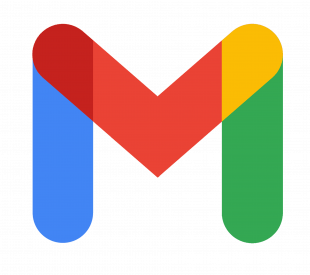
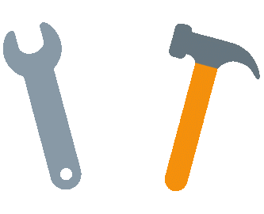
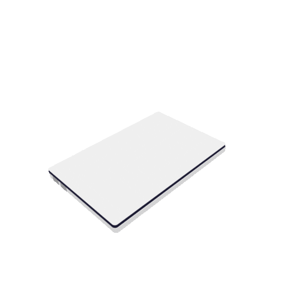
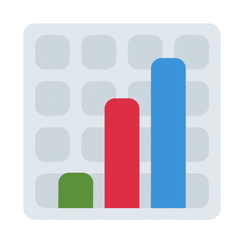

<!-- My Name -->
<h1 align="center">Hi there 👋, I'm Ayman Ahmed</h1>

<!-- Typing -->

  

<!-- Badges -->

  
	&emsp;
 	

<!-- About me -->
##  About me:

---

##  Contact me:

	
	&emsp;
	
	&emsp;
	
	&emsp;

 

##  My tools

###  Programming languages

  

###  Frameworks, Technologies and libraries

  
	&emsp;

<!-- 

 -->

###  Software and tools

	

	
	
	
	<!-- 
	
	 -->

 

##  GitHub Stats

  

<!--
Here are some ideas to get you started:

- 🔭 I’m currently working on ...
- 🌱 I’m currently learning ...
- 👯 I’m looking to collaborate on ...
- 🤔 I’m looking for help with ...
- 💬 Ask me about ...
- 📫 How to reach me: ...
- 😄 Pronouns: ...
- ⚡ Fun fact: ...
-->
